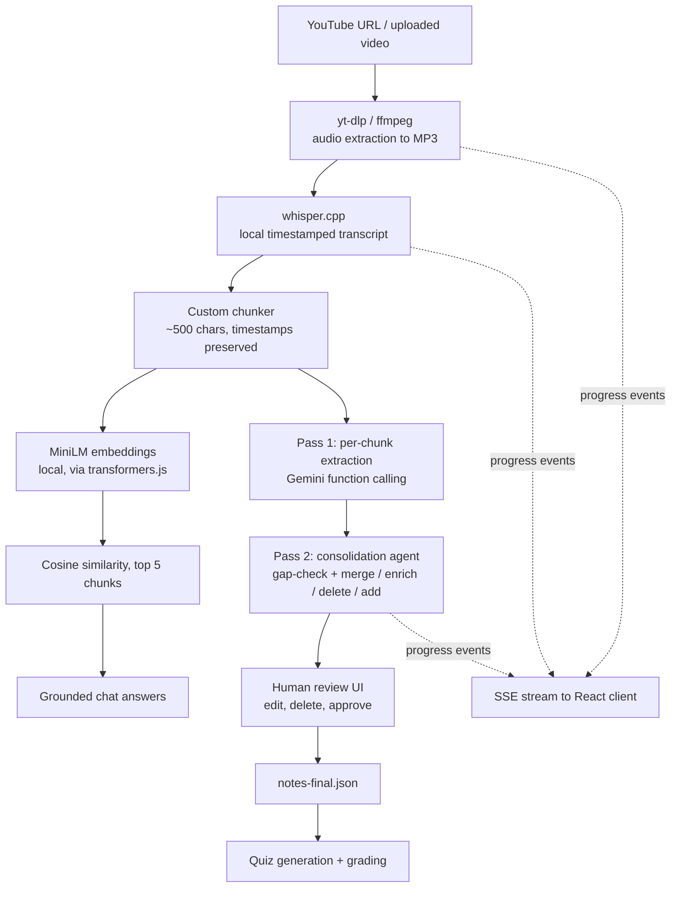

# Marginalia

**Turn any lecture into study material: timestamped notes, a synced player, a chat that knows the video, and a quiz that grades you.**

Paste a YouTube link or upload a video. Marginalia transcribes it locally, extracts definitions, key moments and action items with a multi-pass Gemini agent, lets you review and edit the result, then builds an interactive study session around your approved notes.


## Why this exists

Lectures are long and passive. Most "AI notes" tools hand you a wall of summary and leave you to trust it. Marginalia is built around two ideas:

1. **Every note points back to a moment in the video.** Notes carry start and end timestamps from the transcript, so you can click a note and jump to the source.
2. **A human approves the notes before anything downstream uses them.** The quiz is generated from the notes *you* signed off on, not from raw model output.

I also built the AI pipeline by hand, without LangChain or LlamaIndex, to keep full control over prompts, chunking, retrieval and data fidelity.

---

## The six-step flow

| Step | Page | What happens |
|---|---|---|
| 1 | **Upload** | Paste a YouTube URL or upload a video file. Choose quiz style (multiple choice, mixed, short answer) and question count (3, 5, 10). Preferences persist in `localStorage`. |
| 2 | **Processing** | Live progress over Server-Sent Events: download, transcribe, chunk and embed, extract, consolidate. |
| 3 | **Review notes** | Filter by definitions, key moments or action items. Edit or delete any note. Export a clean study guide as PDF. Approve to continue. |
| 4 | **Watch and sync** | Video on the left, clickable notes on the right. Clicking a note seeks the player; playback highlights the current note. Works for both YouTube embeds and uploaded files. |
| 5 | **Ask questions** | RAG chat over the transcript. Chat history persists per video in `sessionStorage`. |
| 6 | **Take the quiz** | One question at a time, graded instantly. Multiple choice is checked deterministically; short answers are graded by the model with feedback. |

---

## Architecture



**Stack**

| Layer | Technology |
|---|---|
| Frontend | React, Vite, React Router, TypeScript, hand-written CSS (custom properties, print stylesheet) |
| Backend | Node.js, Express, TypeScript, Multer, CORS |
| Media | `yt-dlp`, `ffmpeg` |
| Speech-to-text | `whisper.cpp` (`whisper-cli`, `ggml-small.en` model), runs locally |
| Embeddings | `Xenova/all-MiniLM-L6-v2` via `@xenova/transformers`, runs locally |
| LLM | Google Gemini via `@google/generative-ai` (function calling) |
| Storage | Per-video folders on disk, in-memory progress store |

---

## How the AI pipeline works

### 1. Transcription and chunking
Audio is extracted to MP3 and transcribed locally with whisper.cpp, producing JSON with per-segment timestamps. A custom chunker groups consecutive segments until a chunk passes roughly 500 characters, keeping the first segment's start time and the last segment's end time. Every chunk therefore maps cleanly back to a span of the video.

### 2. Extraction by function calling
Instead of asking the model for free text and parsing it, each chunk is sent to Gemini with three tools:

- `mark_definition`: a term and its explanation
- `flag_key_timestamp`: an important moment and why it matters
- `extract_action_item`: something the viewer should actually do (the tool description explicitly excludes "like and subscribe" and sign-offs)

The server stamps each result with the chunk's timestamps, so the model never has to invent a time.

### 3. A bounded consolidation agent
Per-chunk extraction is noisy: duplicates, sparse notes, the occasional channel plug flagged as homework. A second agent cleans up with an expanded toolset:

- **Gap check.** Chunks are reviewed in batches of five against the notes so far; `add_missed_note` fills anything that slipped through.
- **Review loop.** The agent sees the full notes plus the original chunks and can call `merge_definitions`, `merge_key_timestamps`, `merge_action_items`, `enrich_*`, `delete_note` or `add_missed_note`.
- **Guaranteed termination.** The loop ends when the model calls no tools, and is hard-capped at three passes. Failures in a batch are logged and skipped instead of killing the job.

Both the raw (`notes.json`) and consolidated (`notes-reviewed.json`) versions are saved, so the effect of the consolidation pass can be inspected.

### 4. Retrieval-augmented chat
Chunk embeddings are computed once at ingest. At question time the query is embedded, scored against every chunk with a hand-written cosine similarity function, and the top five chunks are passed to Gemini with a tutor prompt that tells it to speak naturally rather than say "according to the transcript."

### 5. Quiz generation and grading
- Questions are generated **one at a time**, each prompt including the list of questions already asked and an instruction to cover a different concept. This keeps quizzes from repeating themselves.
- Attempts are capped at `2 x count`, so a flaky model response can't loop forever.
- **Mixed** mode alternates multiple choice and short answer.
- **Multiple choice** is graded by exact (case-insensitive) match, with no model call and no ambiguity.
- **Short answer** is graded by Gemini through a `grade_free_text_answer` tool that returns a boolean verdict and feedback, judging meaning rather than wording.

---

## Design decisions

**No orchestration framework.** Chunking, retrieval, tool-call routing and the consolidation loop are plain TypeScript. The pipeline is small enough to read end to end, and every prompt is visible.

**Function calling as structured output.** Tool schemas give typed arguments, and the model's "do nothing" option (no tool call) becomes a clean signal for "nothing left to fix."

**Local-first processing.** Transcription and embeddings run on your machine. Gemini only ever receives text.

**Human in the loop.** The review step is a hard gate: the quiz endpoint reads `notes-final.json`, which only exists after approval.

**SSE over polling from the client.** The browser opens one `EventSource` connection and the server pushes progress as the pipeline moves between stages.

**Deterministic where possible, LLM where necessary.** Multiple choice grading doesn't need a model. Free-text grading does.

**PDF export without a PDF library.** A dedicated print-only document and `@media print` stylesheet turn the approved notes into a formatted study guide through the browser's print dialog.

---

## Getting started

### Prerequisites

- Node.js 18+
- [`yt-dlp`](https://github.com/yt-dlp/yt-dlp) on your `PATH`
- [`ffmpeg`](https://ffmpeg.org/) on your `PATH`
- [`whisper.cpp`](https://github.com/ggerganov/whisper.cpp) with `whisper-cli` on your `PATH`
- The `ggml-small.en.bin` model file, placed at `models/ggml-small.en.bin` in the server directory
- A [Gemini API key](https://aistudio.google.com/)

### Install

```bash
git clone <your-repo-url>
cd marginalia

# backend
cd server
npm install
mkdir -p downloads models      # downloads/ holds per-video artifacts; put the whisper model in models/
cp .env.example .env           # then add your key

# frontend
cd ../client
npm install
```

### Environment variables

```env
GEMINI_API_KEY=your_key_here
GEMINI_MODEL=gemini-3.1-flash-lite   # optional, this is the default
```

### Run

```bash
# terminal 1: API on http://localhost:8080
cd server && npm run dev

# terminal 2: client on http://localhost:5173
cd client && npm run dev
```

Open `http://localhost:5173`, paste a lecture link, and go.

---

## API reference

| Method | Endpoint | Description |
|---|---|---|
| `GET` | `/health` | Health check |
| `POST` | `/process-url` | Start processing a YouTube URL. Returns `202` with the video `id`. |
| `POST` | `/upload` | Upload a video file (multipart). Returns `202` with a generated `id`. |
| `GET` | `/stream/:id` | SSE stream of progress events until `done` or `error` |
| `GET` | `/stream-data/:id` | Fetch the consolidated notes for review |
| `POST` | `/videos/:id/approve-notes` | Save edited or approved notes as `notes-final.json` |
| `POST` | `/videos/:id/ask` | Ask a question about the video (RAG) |
| `POST` | `/videos/:id/generate-quiz` | Generate a quiz: `{ count, quizType }` where `quizType` is `mcq`, `freeText` or `mixed` |
| `POST` | `/videos/:id/generate-mcq-grade` | Grade one answer: `{ questionIndex, studentAnswer }`. Routes to deterministic or LLM grading based on question type. |
| `GET` | `/media/:id/...` | Static access to downloaded and uploaded media |

### What gets written per video

```
downloads/<id>/
├── audio.mp3             # extracted audio
├── video.<ext>           # uploaded videos only
├── transcript.json       # whisper.cpp output with timestamps
├── chunks.json           # chunks with embeddings
├── notes.json            # raw extraction output
├── notes-reviewed.json   # after the consolidation agent
├── notes-final.json      # after human approval
└── quiz.json             # generated quiz and answer key
```

---

## Project structure

```
marginalia/
├── client/
│   └── src/
│       ├── Layout.tsx            # sidebar with the six-step navigation
│       ├── App.tsx               # routes
│       ├── App.css               # design tokens, components, print stylesheet
│       └── pages/
│           ├── UploadPage.tsx
│           ├── ProcessingPage.tsx    # EventSource progress UI
│           ├── NotesPage.tsx         # review, edit, delete, PDF export
│           ├── PlayerPage.tsx        # synced notes for YouTube and local video
│           ├── ChatPage.tsx
│           └── QuizPage.tsx
└── server/
    └── src/
        ├── index.ts          # Express routes, ingest pipelines, chunker
        ├── agent.ts          # extraction, consolidation loop, change application
        ├── tools.ts          # Gemini function declarations
        ├── test-gemini.ts    # model configs (extractor, consolidator, quiz, chat)
        ├── test-embed.ts     # embeddings, cosine similarity, RAG answer
        ├── quiz.ts           # quiz generation, formatting, grading
        └── progress.ts       # in-memory progress store
```

---

## Known limitations and what I'd do next

- **Progress state is in memory.** Restarting the server loses in-flight job status. Next step: persist job state (SQLite or Redis) and make the pipeline resumable per stage.
- **Local-only configuration.** API URLs are hardcoded to `localhost`. Next step: environment-based config and a Vite dev proxy.
- **Single-user, file-based storage.** There is no auth and no database. Next step: user accounts, Postgres plus pgvector for embeddings, and object storage for media.
- **Sequential LLM calls.** Chunks are extracted one at a time. Next step: bounded-concurrency batching with retries and backoff.
- **Embedding model is reloaded per query.** Next step: cache the extractor instance at startup.
- **Chat citations.** Retrieved chunks carry timestamps, and the UI is ready to render a click-to-seek pill, but the answer prompt doesn't yet pass them through. Next step: include timestamps in the context and ask the model to cite them.
- **Evaluation.** Next step: a small labeled set of lectures to measure note precision and recall, and retrieval hit rate for the chat.
- **Testing.** Next step: unit tests for the chunker, `applyChanges` index handling, and quiz formatting, plus an end-to-end test of the ingest pipeline with a short fixture video.
- **Input handling.** YouTube URLs are parsed via the `v` query parameter, so short links (`youtu.be`) aren't supported yet.

---

## Author

**Navdisha Bhakri**, Software Engineering student. Built end to end: media pipeline, retrieval, agent loop, API, and UI.
